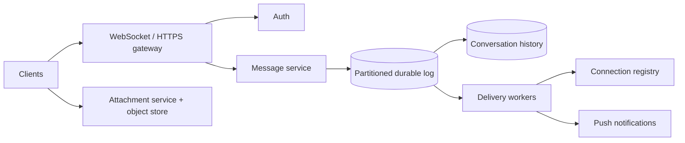

# Design Chat System (WhatsApp / Slack)

## Requirements and scale assumptions

Support authenticated one-to-one and group conversations, ordered message history, acknowledgements, online delivery, offline sync, attachments, and optional read receipts. Clarify end-to-end encryption, retention, search, group size, and multi-device guarantees. At 100M daily users × 40 messages/day, ingest is ~4B/day (46k/s average; perhaps 5x peak); fan-out and connection count exceed message compute.

## Architecture

## APIs and data

- `POST /v1/conversations/{id}/messages` with `clientMessageId`, body/ciphertext and attachment refs → accepted message sequence.
- `GET /v1/conversations/{id}/messages?before=cursor&limit=...`; `POST .../acks` for delivered/read cursor.
- `Conversation(id, members, membershipVersion, policy)`; `Message(conversationId, sequence, senderId, clientMessageId, payloadRef, createdAt)` keyed by conversation + sequence; `DeviceCursor(userId, deviceId, conversationId, lastSeenSequence)`.

Partition per conversation keeps order local; assign monotonically increasing sequence at the write leader. Idempotency key handles client retry after uncertain acknowledgement. Large attachments go through signed upload URLs and malware scanning. Offline sync uses cursors, not full-history polling.

## Failure modes and trade-offs

Hot celebrity/group rooms create fan-out hotspots; split delivery work and cap synchronous fan-out. Gateway loss reconnects clients with backoff and cursor replay. Cross-region writes introduce conflict/order choices. Push services are best-effort wakeups, not message storage. Acknowledgement, delivery, and read are distinct states. Search conflicts with end-to-end encryption; preserve threat model.

## Security and observability

Use device/session authentication, membership checks at read and send time, rate limits, abuse reporting, encrypted transport/storage, and (if required) audited E2E key lifecycle. Avoid logging plaintext. Observe active connections, reconnect storms, send-to-ack latency, queue lag, per-conversation hot partitions, offline backlog, push failures, and message loss/duplicate indicators.

## References

- [RFC 6455: WebSocket Protocol](https://www.rfc-editor.org/rfc/rfc6455)
- [Signal: Double Ratchet specification](https://signal.org/docs/specifications/doubleratchet/)
- [Slack Engineering: Scaling Slack](https://slack.engineering/scaling-slack/)
