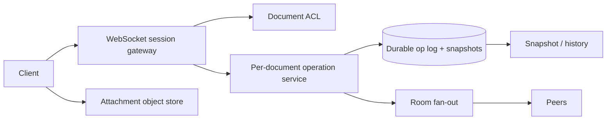

# Design Collaborative Editor (Google Docs)

## Requirements and scale

Multiple authenticated users concurrently edit a document, see remote changes, recover offline work, maintain history, and share permissions. Clarify rich-text semantics, offline duration, conflict policy, comment support, and regional collaboration. Assume 1M active editing sessions, 10 edits/s/session for active documents (~10M operations/s theoretical peak); practical load is skewed to hot documents.

## Architecture

## API and data

- `POST /v1/docs` creates document; `GET /v1/docs/{id}/snapshot?version=...`.
- WebSocket `JOIN(docId, cursor, clientId)`, `OP(docId, opId, baseVersion, operation)`, `ACK(version)`.
- `Document(id, ownerId, aclVersion, snapshotRef, currentVersion)`; append-only `Operation(docId, version, opId, actor, transformedOperation, timestamp)`.

Choose an operation model deliberately. OT transforms concurrent operations against server order; CRDTs encode mergeable state and support offline merge with metadata costs. Persist before broadcasting or define recoverability semantics. Snapshots bound replay; retain op history for undo/audit according to policy.

## Failure modes and trade-offs

Reconnect replays from a cursor; duplicate op IDs must be idempotent. Hot document single-writer sequencer becomes a bottleneck but simplifies order. Multi-region concurrent editing reduces latency but increases merge complexity. Lost ACK leaves client uncertain; retry with op ID. Snapshot corruption must be recoverable from verified log. Rich-text schema migration and deleted content require version-aware transforms.

## Security, observability

Check ACL on join and operation, re-check after permission revocation, isolate tenants, encrypt content and transport, protect share links, and log audit events without capturing document text. Measure op-to-visible latency, reconnect/replay success, sequence conflicts, hot-doc queue depth, snapshot age, persistence lag, ACL denial, and data divergence.

## References

- [Google Research: Operational Transformation](https://research.google/pubs/operational-transformation-in-real-time-group-editors-the-consistency-challenge/)
- [Automerge: CRDT documentation](https://automerge.org/docs/)
- [RFC 6455: WebSocket Protocol](https://www.rfc-editor.org/rfc/rfc6455)
