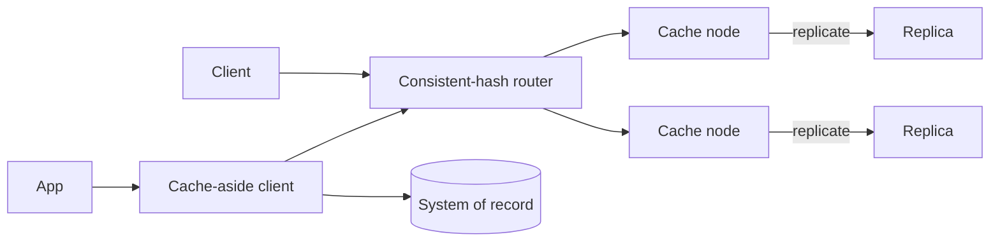

# Design Distributed Cache

## Requirements and scale

Provide low-latency `get/put/delete`, TTL, bounded memory, eviction, replication/failover, and optionally consistency guarantees. Clarify object sizes, hot-key skew, write rate, persistence, and acceptable stale reads. Illustrative: 1M keys, 100k ops/s, 1–5 ms service latency goal; memory cost and network fan-out are material.

## Architecture

## API and data

- `GET /v1/cache/{key}` returns value/version/remaining TTL or miss; `PUT` supports TTL and optional compare-version; `DELETE` invalidates.
- Entry `(keyHash, valueBytes, version, expiresAt, lastAccess)`; shard ownership via consistent/rendezvous hash. Avoid unbounded keys and values.
- Cache-aside: application reads cache then origin; writes commit to source of truth then invalidate/update cache, with an outbox for reliable invalidation if required.

## Failure modes and trade-offs

Eviction creates origin stampedes; coalesce misses, add TTL jitter, and protect origin with admission control. Hot keys overwhelm one node; replicate/read-split or cache at edge. Node loss causes remapping and cold-cache surge. TTL expiry is not a correctness guarantee. Strong consistency across replicas raises write latency/availability complexity; for most derived data, bounded staleness is simpler. Cache must not be sole durable storage.

## Security and observability

Authenticate clients, isolate tenants/namespaces, encrypt transport, protect sensitive values, and prevent cache poisoning/key collisions. Track hit/miss by bounded dimension, eviction, memory/fragmentation, p99 latency, replication lag, hot keys, origin load, invalidation lag, and stampede frequency.

## References

- [Redis: Cache-aside pattern](https://redis.io/docs/latest/develop/use/patterns/cache-aside/)
- [Memcached: User guide](https://docs.memcached.org/userguide/)
- [Akamai: Consistent hashing overview](https://techdocs.akamai.com/edgekv/docs/consistent-hashing)
