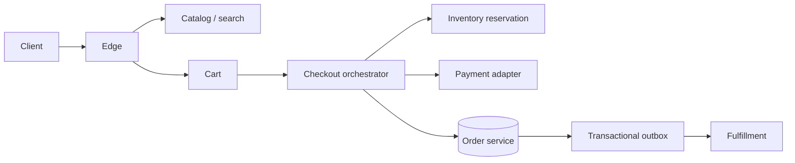

# Design E-Commerce (Amazon)

## Requirements and scale

Browse catalog, search, manage cart, calculate price/tax/shipping, place orders, reserve stock, pay, and track shipment. Clarify marketplace boundaries, inventory accuracy, promotions, returns, and regional/legal rules. Example peak: 100k browse requests/s and 5k checkout attempts/s during a sale; read-heavy catalog can be stale, inventory oversell must be bounded.

## Architecture

## APIs and data

- `GET /v1/products/{id}`; `PUT /v1/carts/{id}/items/{sku}` with quantity; `POST /v1/checkout` with idempotency key.
- `Order(orderId, customerId, state, totals, currency, version)`; `OrderLine(orderId, sku, priceSnapshot, qty)`; `Inventory(sku, location, available, reserved, version)`; `Reservation(id, orderId, expiry, state)`.
- Checkout returns `202`/order status when workflows are asynchronous; money uses integer minor units or decimal-safe representation and currency code.

## Consistency and workflow

Search/catalog are eventually consistent. Checkout revalidates price, eligibility, and inventory. Reserve stock with an expiring idempotent reservation; coordinate payment and order transitions via saga/outbox and compensating actions. Do not hold a DB transaction across a payment network call.

## Failure modes and trade-offs

Flash-sale hot SKUs need queueing, admission control, and fair allocation. Payment timeout is ambiguous; reconcile provider state before retry. Inventory updates can oversell if reservation and decrement race. Event duplication requires idempotent consumers. Search outage should preserve direct product/cart/checkout paths where safe; checkout should fail closed if price or stock cannot be verified.

## Security and observability

Authorize customer-owned carts/orders, protect PII, tokenize payment data, validate promotions, enforce fraud controls, and audit administrative price/inventory edits. Track checkout conversion, reservation contention/expiry, payment authorization/capture mismatch, order-state age, inventory drift, queue lag, and per-step latency.

## References

- [AWS Prescriptive Guidance: Saga pattern](https://docs.aws.amazon.com/prescriptive-guidance/latest/cloud-design-patterns/saga.html)
- [Stripe: Idempotent requests](https://docs.stripe.com/api/idempotent_requests)
- [PCI Security Standards Council: PCI DSS](https://www.pcisecuritystandards.org/standards/pci-dss/)
