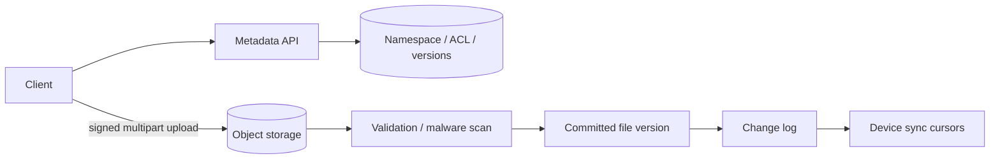

# Design File Storage (Google Drive / Dropbox)

## Requirements and scale

Upload/download large files, list folders, share with permissions, preserve versions, sync changes across devices, and delete/restore. Clarify collaboration, offline clients, maximum size, consistency, encryption, and retention. Example: 10M DAU × 10 changes/day = 100M metadata events/day (~1.2k/s average) plus highly variable media bytes; object storage bandwidth dominates.

## Architecture

## API and model

- `POST /v1/files` creates upload session; `PUT` chunks to scoped signed URLs; `POST /v1/uploads/{id}/commit` verifies checksums.
- `GET /v1/files/{id}/content?version=...`; `GET /v1/changes?cursor=...`.
- `Node(id, parentId, ownerId, name, type, version, acl, tombstone)`; `Blob(blobId, checksum, size, storageKey, scanStatus)`; `Revision(fileId, version, blobId, createdAt)`.

Metadata DB owns namespace, permissions, and version pointers; blob store owns immutable bytes. Use resumable multipart transfer and content hashes but avoid cross-tenant deduplication leakage.

## Failure modes / trade-offs

Metadata commit and blob write are not one transaction: stage object, verify, then atomically publish pointer; garbage collect orphaned uploads. Concurrent rename/move and offline edits need version/conflict semantics. Sync cursors must survive client loss and retention. ACL caches risk data exposure; permission revocation should invalidate quickly. Strong metadata consistency costs availability/latency across regions.

## Security and observability

Check ACL on every access, encrypt in transit/at rest, scan/quarantine files, protect signed URLs, prevent path traversal and share-link enumeration, audit sharing, and define retention/deletion guarantees. Track upload completion/error, sync lag, conflict rate, blob integrity, ACL denial, orphan bytes, download latency, and restore success.

## References

- [Google Drive API: Upload files](https://developers.google.com/drive/api/guides/manage-uploads)
- [Dropbox: Sync API concepts](https://developers.dropbox.com/sync)
- [RFC 7578: multipart/form-data](https://www.rfc-editor.org/rfc/rfc7578)
