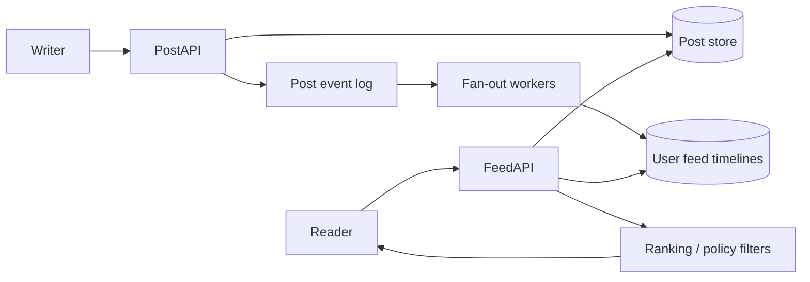

# Design News Feed (Twitter / Instagram)

## Requirements and assumptions

Publish posts, follow users, produce a personalized chronological or ranked feed, paginate, delete content, and enforce privacy/blocking. Clarify freshness, ranking, media, and whether feed may be slightly stale. Assume 100M DAU, 5 posts/user/day (500M posts/day, ~5.8k/s average), and 20 feed reads/user/day (~23k/s average); peak and celebrity fan-out dominate.

## Architecture

## APIs and data

- `POST /v1/posts {text, mediaRefs, audience}` with idempotency key.
- `GET /v1/feed?cursor=...&limit=...` returns opaque stable cursor and cards.
- `POST /v1/follows/{userId}`; delete/block operations trigger privacy enforcement.
- `Post(postId, authorId, createdAt, audience, body/mediaRefs, version)`; `Follow(followerId, followeeId)`; `Timeline(userId, rankedCandidateIds, sourceSequence, expiresAt?)`.

Hybrid fan-out: push on write for ordinary users, pull on read for high-follower accounts; merge and rank candidates at read time. Apply authorization and deletions even when timeline entries are cached.

## Bottlenecks, failure modes, trade-offs

Write fan-out amplifies hot creators; read fan-out costs latency and repeated compute. Hybrid mode adds complexity and stale merges. Feed caches can leak content if privacy checks are omitted. Ranking features risk feedback loops and abuse. Event replay must be idempotent; a failed fan-out causes missing cards, so repair/rebuild from source posts.

## Security and observability

Authorize every post at render time, enforce block/mute and deletion propagation, rate-limit spam, moderate content, and minimize personal data. Measure feed p95/p99, candidate count, freshness lag, cache hit rate, fan-out backlog, empty-feed rate, ranking errors, privacy-filter removals, and distribution/fairness indicators.

## References

- [X API: Timelines](https://developer.x.com/en/docs/x-api/tweets/timelines/introduction)
- [Meta Engineering: News Feed ranking](https://engineering.fb.com/2021/01/26/core-infra/news-feed-ranking/)
