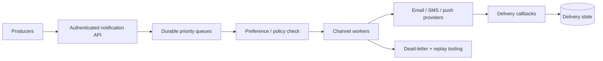

# Design Notification System

## Requirements and scale

Accept transactional and user-engagement notifications, honor opt-outs/preferences, support email/push/SMS/in-app providers, retries, deduplication, and delivery status. Prioritize correctness and provider compliance over exactly-once claims. Example: 50M users, 10M notification intents/day (~116/s average), bursty campaigns reaching 20k/s; provider quotas may dominate compute.

## Architecture

## APIs and data

- `POST /v1/notifications` with `eventId`, recipient, templateId, channel, locale and bounded variables; return `202 {notificationId}`.
- `GET /v1/notifications/{id}` returns state, not provider secrets.
- `Preference(userId, channel, category, consent, updatedAt)`; `Notification(id, eventId, recipientRef, templateVersion, state, attempt, scheduledAt)`; `DeliveryAttempt(id, notificationId, provider, result, nextRetryAt)`.

Deduplicate on producer event + recipient + channel. Store template versions, not only mutable names. Keep PII minimized and encrypted; retention is channel/legal-policy specific.

## Failure modes and trade-offs

Provider outages/backpressure require per-provider queues, circuit breakers, retry with jitter, and DLQs. A timeout after provider acceptance creates ambiguous delivery; exactly-once delivery is generally unavailable, so design idempotent intent and at-least-once attempts with duplicate-tolerant content. Campaign traffic must not starve OTP/security messages. Callback webhooks need verification and replay defense.

## Security and observability

Enforce consent, tenant boundaries, template escaping, secret rotation, PII access audit, and abuse/spam controls. Measure queue age/depth by priority, accepted-to-delivered latency, provider throttles/errors, duplicate suppression, bounce/complaint rates, opt-out lag, DLQ volume, and cost per channel. Alert when critical messages approach their delivery deadline.

## References

- [RFC 8030: Generic Event Delivery Using HTTP Push](https://www.rfc-editor.org/rfc/rfc8030)
- [Apple: User Notifications](https://developer.apple.com/documentation/usernotifications)
- [Firebase: FCM message delivery](https://firebase.google.com/docs/cloud-messaging)
