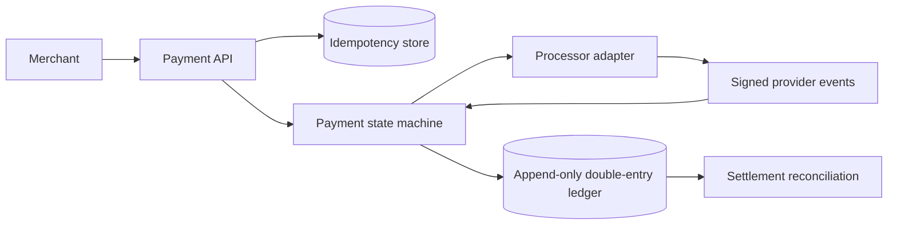

# Design Payment System

## Requirements and trust boundary

Accept payment intents, authorize/capture/refund through external processors, expose reliable state to merchants, reconcile settlements, and detect fraud. Clarify supported methods/currencies, SCA/3DS, refunds, chargebacks, and ledger semantics. Never design as if a network timeout means a failed charge.

## Architecture

## APIs and data

- `POST /v1/payment-intents` with amount in minor units, currency, merchant reference, and idempotency key → intent ID/state.
- `POST /v1/payment-intents/{id}/confirm`; `POST .../capture`; `POST .../refunds`.
- `PaymentIntent(id, merchantId, amount, currency, state, providerRef, version)`; `Idempotency(merchantId, key, requestHash, response)`; append-only `LedgerEntry(account, debit/credit, amount, currency, reference)`.

State transitions are explicit and validated; immutable ledger entries preserve accounting history. Provider adapter translates capabilities without erasing processor-specific statuses. Webhooks require signature verification, replay protection, and idempotent event processing.

## Failure modes and trade-offs

Timeout after authorization is ambiguous: query/reconcile before retry; use stable processor idempotency keys. Duplicate webhooks are expected. Ledger and external provider cannot share a transaction; reconcile continuously and isolate discrepancies. High availability cannot justify silently inventing a final payment state. Queue delayed confirmation and expose pending state.

## Security and observability

Minimize cardholder data; use tokenized hosted fields/processor tokens and follow applicable PCI scope. Authenticate merchants, authorize account scope, encrypt secrets, rotate keys, and audit refunds. Track authorization/capture/refund rates, pending-state age, webhook lag/signature failures, ledger imbalance, reconciliation discrepancy, processor latency, and duplicate suppression.

## References

- [PCI Security Standards Council: PCI DSS](https://www.pcisecuritystandards.org/standards/pci-dss/)
- [Stripe: Payment Intents API](https://docs.stripe.com/payments/payment-intents)
- [Stripe: Idempotent requests](https://docs.stripe.com/api/idempotent_requests)
- [Adyen: Webhooks](https://docs.adyen.com/development-resources/webhooks/)
