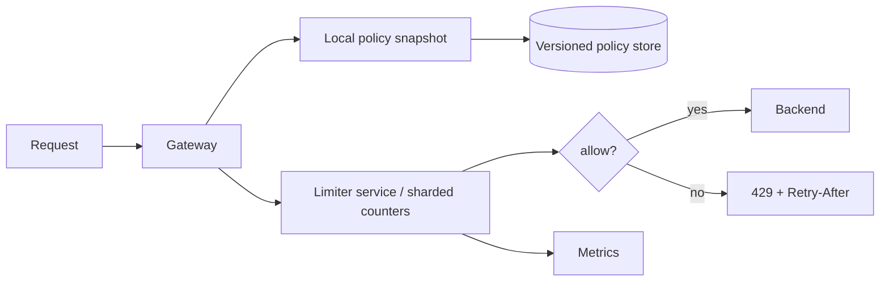

# Design Rate Limiter

## Requirements and scale

Enforce configurable limits by principal, API, and possibly tenant; support burst policy, distributed clients, and explainable `429` responses. Distinguish strict quota from best-effort abuse control. Example: 1M active keys, 20k requests/s average, 100k/s peak; counters must not become a single hot global row. Clarify acceptable overshoot and window semantics.

## Architecture

## API and data model

- Internal `Check(principal, route, cost, idempotencyKey?) -> {allowed, remaining, resetAt, policyVersion}`.
- External response: `429 Too Many Requests`, optionally `Retry-After` per RFC; avoid revealing sensitive policy internals.
- `Policy(policyId, scope, algorithm, limit, interval, burst, version, effectiveAt)`; `Counter(shard, scopeHash, windowStart, count, expiresAt)`.

Token bucket supports bursts and steady refill; fixed windows are simple but permit boundary bursts; sliding logs are accurate but expensive; sliding-window counters approximate. For high throughput, shard by key and use atomic increments or local token leases with bounded overshoot.

## Failure modes and trade-offs

Limiter outage: fail-open protects availability but risks abuse; fail-closed protects quota but can cause broad outage. Choose per route/risk and document. Clock skew affects time windows. Hot tenants cause hot partitions. Config rollout must avoid sudden counter resets. Retries need idempotent debit semantics. In-process fallback limits are approximate and can multiply by instance count.

## Security, observability, validation

Authenticate before identity-based limits; canonicalize keys to prevent bypass; protect policy admin. Do not use unbounded raw identifiers as metric labels. Track allowed/denied counts, decision latency, backend errors, policy version, overshoot, hot partitions, and fail-open events. Test boundary times, concurrency, clock skew, tenant isolation, config propagation, and outage modes.

## References

- [RFC 6585 §4: 429 Too Many Requests](https://www.rfc-editor.org/rfc/rfc6585#section-4)
- [Redis: Rate limiter patterns](https://redis.io/learn/howtos/ratelimiting)
- [Envoy: Global rate limiting](https://www.envoyproxy.io/docs/envoy/latest/intro/arch_overview/other_features/global_rate_limiting)
