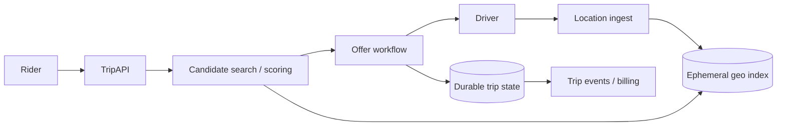

# Design Ride Sharing (Uber / Ola)

## Requirements and scale

Riders request trips; drivers publish location/availability; system matches, quotes, tracks, completes, and settles trips. Clarify dispatch radius, cancellation, ETA, surge, safety workflows, and regional rollout. At 1M concurrent drivers sending a location every 5s, ingest is 200k updates/s before replication; geospatial indexing and freshness dominate.

## Architecture

## API and data

- `POST /v1/trips` with pickup, destination, idempotency key → quote/trip state.
- `POST /v1/drivers/{id}/locations` timestamped coordinates and accuracy; `POST /v1/trips/{id}/accept`.
- `Trip(id, riderId, driverId, state, quote, version, createdAt)`; `DriverAvailability(driverId, state, geoCell, lastSeenAt)`; append-only `TripEvent`.

Keep high-rate location in a TTL geospatial index; authoritative trip transitions in durable storage with optimistic version checks. Match nearby candidates, then filter eligibility and score ETA; dispatch offers require leases/expiry to prevent double assignment.

## Failure modes / trade-offs

Stale GPS causes bad matches; reject old timestamps and track uncertainty. Concurrent offers can double-book; atomic state transition/lease is required. Regional partition limits global coordination. Cell hotspots and city events create uneven load. Network loss must degrade location freshness and permit safe trip completion/reconciliation.

## Security, observability

Protect precise location as highly sensitive data; restrict retention/access, encrypt, audit, and disclose usage. Verify driver/rider identity, prevent spoofing, and rate-limit APIs. Track location age, match latency/acceptance, offer expirations, double assignment, ETA error, trip-state transition lag, cancellation, and emergency escalation.

## References

- [Uber Engineering: H3 geospatial indexing](https://www.uber.com/blog/h3/)
- [Google Maps Platform: Routes API](https://developers.google.com/maps/documentation/routes)
- [RFC 7946: GeoJSON](https://www.rfc-editor.org/rfc/rfc7946)
