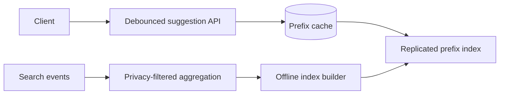

# Design Search Autocomplete

## Requirements and scale

Return a small ranked set of query suggestions while a user types, support prefix and locale/category context, update popular terms, and exclude unsafe/stale results. Clarify personalization, privacy, language, freshness, and p99 budget. Illustrative: 20M DAU × 8 sessions × 5 keystrokes = 800M lookups/day (~9.3k/s average; >50k/s peak); query latency target may be <100 ms end-to-end.

## Architecture

## API and data

- `GET /v1/suggestions?q=...&locale=...&limit=10` returns suggestions, index version, and optional safe opaque cursor.
- `Suggestion(normalizedPrefix, candidate, locale, score, policyVersion, validUntil)`; query event aggregates should use privacy thresholds and retention limits.
- Build immutable index snapshots and atomically swap version pointers; cache keys include locale and policy version.

Trie offers prefix lookup but can be memory-heavy; FST/compact sorted structures reduce memory with build/update complexity. Shard by prefix range or locale; replicate hot short prefixes. Debounce client requests and cancel stale responses.

## Failure modes and trade-offs

Short prefixes are hot and low-information; cap minimum length and cache aggressively. Index refresh lag makes new terms stale. Snapshot rollout needs memory headroom. Personalization increases privacy and cache-cardinality costs. A safety-filter outage should fail to a conservative curated list, not expose unreviewed content.

## Security, observability

Minimize/aggregate query logs, apply retention and access controls, filter personal/sensitive terms, defend against poisoning, and rate-limit scraping. Measure p95/p99, cache hit rate, index age/swap errors, no-result rate, freshness, safety-filter drops, and abuse signals. Evaluate relevance and safety offline with versioned datasets.

## References

- [Lucene: Finite State Transducers](https://lucene.apache.org/core/9_12_0/core/org/apache/lucene/util/fst/package-summary.html)
- [Google SRE Book: Handling overload](https://sre.google/sre-book/handling-overload/)
