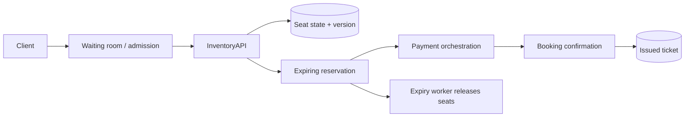

# Design Ticket Booking (BookMyShow)

## Requirements and scale

Browse events/seats, hold selected inventory briefly, pay, confirm tickets, and cancel/refund by policy. Clarify assigned vs general admission, hold duration, queueing, payment methods, and seat-map freshness. Peak demand is highly skewed: 100k concurrent users may contend for a few thousand seats; preventing double sale matters more than global availability.

## Architecture

## API and data

- `GET /v1/events/{id}/seats`; `POST /v1/holds` with event, seat IDs, idempotency key → hold token/expiry.
- `POST /v1/bookings` with hold token and payment reference; `GET /v1/bookings/{id}`.
- `Seat(eventId, seatId, state, bookingId?, version)`; `Hold(id, userId, seats, expiresAt, state)`; `Booking(id, userId, state, total, version)`.

Acquire seats atomically (transaction/conditional version update); use short leases with server time. Confirm payment via saga and idempotent transitions; expiry worker safely releases only still-held seats. For general admission, use atomic bounded inventory counters/leases.

## Failure modes / trade-offs

Oversell may arise from stale clients, duplicate holds, or race conditions. Payment success after hold expiry needs explicit compensation/reacquisition/refund. Hot event partitions require queueing/fairness, backpressure, and anti-bot protections. Expiry processing lag temporarily reduces saleable inventory; monitor and reconcile. Waiting rooms reduce overload but add user-visible queue fairness trade-offs.

## Security and observability

Protect account/payment data, sign hold tokens, rate-limit and bot-detect, prevent seat enumeration, audit administrative overrides, and use PCI-scoped payment integration. Measure hold contention, booking success, hold-to-payment conversion, expiry lag, duplicate purchase, payment/booking mismatch, queue wait, and oversell (target zero).

## References

- [Stripe: Idempotent requests](https://docs.stripe.com/api/idempotent_requests)
- [AWS Prescriptive Guidance: Saga pattern](https://docs.aws.amazon.com/prescriptive-guidance/latest/cloud-design-patterns/saga.html)
- [RFC 9110: Conditional requests](https://www.rfc-editor.org/rfc/rfc9110#name-conditional-requests)
