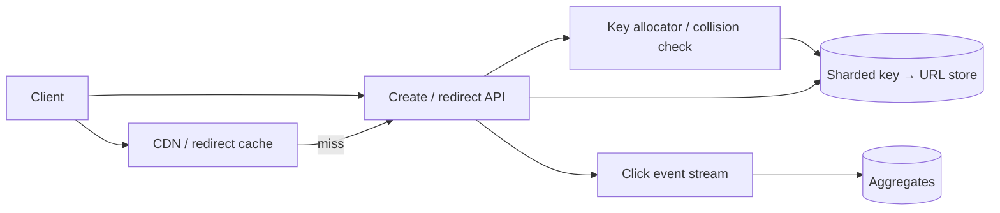

# Design URL Shortener (TinyURL)

## Requirements and boundaries

Functional: create a short link for a validated URL, redirect quickly, optionally accept a user alias/expiry, and support abuse reporting. Non-functional: high read availability and low redirect latency; creation can be less available. Clarify public/private links, edit/delete semantics, analytics freshness, and expiration policy. Do not crawl destinations as part of a redirect.

## Scale estimate (illustrative)

Assume 100M new links/month, 10B redirects/month, 5-year retention. At roughly 100 bytes of compact key+URL metadata, raw active mapping is about 600 GB before indexes/replication. 10B/month averages ~4k redirects/s; a 10x peak is ~40k/s. Caches absorb hot links; analytics events are an independent write stream.

## Architecture

## API and data

- `POST /v1/links {url, customAlias?, expiresAt?}` → `201 {key, shortUrl, expiresAt}`; idempotency key prevents duplicate creation on retry.
- `GET /{key}` → `301/302 Location: ...`; choose permanence carefully because clients/CDNs cache redirects.
- `DELETE /v1/links/{key}` → authenticated owner-only tombstone (if supported).
- `Link(key PK, destination, ownerId?, createdAt, expiresAt?, status, version)`; store creation request idempotency separately with TTL.

Use base62 random or allocated IDs with uniqueness constraint; do not expose sequential IDs if enumeration is a concern. Shard by key. Keep tombstones long enough to prevent accidental reuse.

## Bottlenecks, failures, trade-offs

Hot keys overwhelm origin without edge caching; invalidation is hard after destination edits. Cache miss storms need request coalescing. Key collisions retry safely. Database partition loss should fail closed for unknown links rather than redirect incorrectly. Click tracking should be asynchronous and lossy by policy; redirect correctness takes precedence. `301` improves cache efficiency but limits revocation; `302/307` offers more control at added latency.

## Security and observability

Validate schemes, reject dangerous protocols, defend against SSRF in any preview crawler, apply malware/phishing checks, rate-limit creators, and protect user data. Measure redirect p50/p95/p99, cache hit rate, lookup errors, create collision/retry rate, hot-key load, expiration lag, and event-stream lag. Alert on redirect SLO and abusive creation anomalies.

## References

- [RFC 9110: Redirection](https://www.rfc-editor.org/rfc/rfc9110#name-redirection-3xx)
- [RFC 3986: URI Generic Syntax](https://www.rfc-editor.org/rfc/rfc3986)
