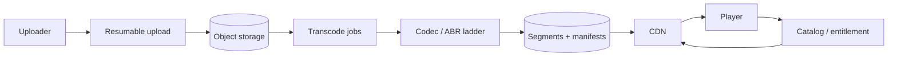

# Design Video Streaming (YouTube / Netflix)

## Requirements and scale

Ingest uploads, validate/transcode to adaptive bitrate renditions, store durable media, serve globally, resume playback, and enforce entitlements/rights. Clarify live vs VOD, DRM, regions, latency, resolution, and creator workflow. For an illustrative 50M daily viewers × 1 hour × 3 Mbps average, egress is roughly 67.5 PB/day; CDN delivery dominates origin and cost.

## Architecture

## APIs and data

- `POST /v1/uploads` returns scoped multipart session; `POST /v1/uploads/{id}/complete`.
- `GET /v1/videos/{id}/playback` checks entitlement and returns short-lived manifest URL/token.
- `Video(id, ownerId, state, rightsRegion, metadata)`; `Rendition(videoId, codec, bitrate, resolution, manifestRef)`; `PlaybackSession(id, userId, videoId, entitlement, expiresAt)`.

Use resumable chunks and checksums; transcode asynchronously with retryable job IDs. Segment/media store is immutable and CDN-cacheable; manifests or signed access have controlled TTL.

## Failure modes and trade-offs

Transcode queue backlog delays availability; poison media needs quarantine. CDN miss storms and regional origin failures need shielding, replication, and graceful bitrate fallback. Codec choices trade quality, CPU cost, device compatibility, and storage. Stale rights metadata may expose content. Live delivery has tighter latency and different buffering/consistency constraints than VOD.

## Security, observability

Validate media, scan uploads, isolate decoders, enforce rights/DRM where required, scope signed URLs, and protect user identity. Observe startup delay, rebuffer ratio, playback errors, bitrate switches, CDN hit ratio/egress, transcode age/failure, upload completion, and entitlement denials by region/device.

## References

- [Apple: HTTP Live Streaming](https://developer.apple.com/streaming/)
- [DASH Industry Forum: MPEG-DASH](https://dashif.org/)
- [Google: VP9 video codec](https://developers.google.com/media/vp9)
